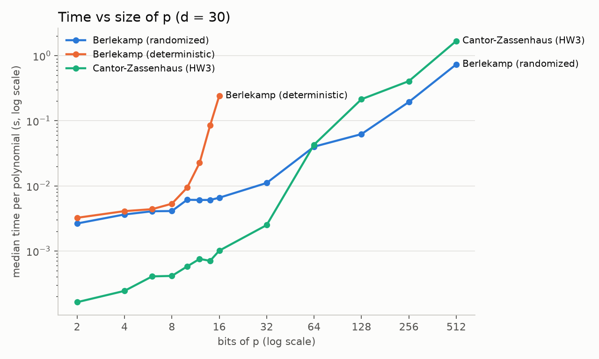

# KerSplit: Factoring Polynomials over Z_p with Berlekamp's Algorithm

**Course:** CS5610 Computational Number Theory and Algebra, IIT Hyderabad (Jul-Nov 2026), Prof. N. R. Aravind
**Project topic (#19):** Berlekamp's algorithm for polynomial factorization (Medium)
**Team:** _Member 1_, _Member 2_, _Member 3_
**Presentation:** project week, 2026-11-19 to 2026-11-21

> **Why "KerSplit"?** The algorithm in two words: compute a **kernel** (the null space of `Q - I`),
> then **split** `f` with gcds against the vectors in that kernel.

**Quick start** (Linux, macOS, or Windows through WSL2; details in [Section 4](#4-running-it-on-your-laptop)):

```bash
git clone git@github.com:saideepaksana/kersplit.git && cd kersplit
make env        # once, 10-20 minutes: installs SageMath into a conda env called "sage"
make check      # confirms Python, Sage, pytest and Jupyter work
make example    # factors x^4 + 1 mod 3 and prints every step
make test       # 66 tests, about 1 minute
```

---

## 1. Problem statement

**Input:** a prime `p` and a non-zero polynomial `f(x)` in `Z_p[x]` of degree `d`, in the same
`p:` / `d:` / `f:` format as Programming HW3.

**Output:** the complete factorization `f = c * h_1^e_1 * h_2^e_2 * ... * h_k^e_k` into distinct monic
irreducibles `h_i` with multiplicities `e_i`, plus the number of distinct irreducible factors,
which Berlekamp's method finds *before* it finds any factor.

In class (notes, Ch. 7) we solved this with Cantor-Zassenhaus: square-free part, distinct-degree
factorization, then random splitting via `g^((p^i - 1)/2)`. Berlekamp's algorithm (1967) keeps
Phase 1 and replaces Phases 2 and 3 with **linear algebra over Z_p**:

1. For square-free `f`, the polynomials `g` with `g^p = g (mod f)` form a vector space `B` over
   `Z_p`, the *Berlekamp subalgebra*.
2. `B` is the kernel of `Q - I`, where row `i` of the `d x d` matrix `Q` holds the coefficients of
   `x^(ip) mod f`.
3. By the CRT for polynomials (notes, Theorem 13), `Z_p[x]/(f)` is isomorphic to the product of the
   fields `Z_p[x]/(h_i)`, and `g^p = g` in a field means `g` lies in `Z_p`. So `B` is `r` copies of
   `Z_p` and **`dim B = r`, the number of irreducible factors.** If `r = 1`, `f` is irreducible.
4. Since `g^p - g = prod over s in Z_p of (g - s)`, any non-constant `g` in `B` gives
   `f = prod over s of gcd(f, g - s)`, a nontrivial split. This is **deterministic**.
5. For large `p` (such as HW3's `p = 987013`, or 512-bit primes), trying all `p` values of `s`
   is impossible. Instead pick a random `g` in `B` and take `gcd(f, g^((p-1)/2) - 1)`: each factor
   divides it independently with probability `(p-1)/(2p)`, about 1/2, the same argument as Claim 14
   in the notes.

**Worked example (checked in Sage):** `x^4 + 1` is irreducible over Z, but modulo 3 the kernel of
`Q - I` has basis `{1, x^3 + x}`. So `r = 2`, and the gcds with `x^3 + x - s` give
`x^4 + 1 = (x^2 + x + 2)(x^2 + 2x + 2) mod 3`. It also splits into 2 factors mod 5, 7, 11 and 13.

**The question the talk answers:** deterministic Berlekamp runs in time polynomial in `d` and `p`,
not in `log p`. That is why it does not settle the open problem from the 2026-10-09 class post
(deterministic polynomial-time factoring over Z_p), and why the randomized variant is the one used
for large `p`.

## 2. Scope

**Language:** Python files (`.py`) that import SageMath (`from sage.all import ...`), run with the
`sage` conda env's Python. Not `.sage` files, because those cannot be imported by other files.
Write `x**3`, not `x^3`, and `R = PolynomialRing(GF(p), "x"); x = R.gen()`.

**Build:**
- Square-free factorization **with multiplicities**, including the case where `h^p` divides `f`
  (extends Algorithm 7 of the notes).
- The Q-matrix, built with repeated squaring for `x^p mod f`.
- Null space of `Q - I` by our **own Gaussian elimination over Z_p**.
- Deterministic split (small `p`) and randomized split (large `p`), with `p = 2` handled.
- A driver that reads HW3-style input and prints the factorization.
- A `trace=True` mode that prints every step (square-free check, `Q`, kernel basis, each gcd), for the demo.

**Use Sage only for:** arithmetic in `GF(p)['x']` (`+`, `*`, `%`, `gcd`), as in HW3. Sage's
`factor()` and `kernel()` are used only in tests, to check our answers.

**Evaluate:** run it on the three HW3 samples and on random products of known irreducibles.
Compare running time with our own HW3 Cantor-Zassenhaus code for growing `d` and `p` (a timing table).

**Not built (one slide at most):** factoring over Z (Hensel lifting, LLL), extension fields
`F_(p^k)`, fast variants (Kaltofen-Shoup, Wiedemann), and coding-theory applications.

## 3. Work split (each member owns code and about 5 minutes of the talk)

| Member | Code they own | What they present |
|---|---|---|
| **1: Setup and Q-matrix** | `polyio.py` (HW3-style input and output), `squarefree.py` (square-free factorization with multiplicities), `qmatrix.py` | The problem; why square-free input is needed and the `h^p` case; building `Q`; the `Q` matrix for `x^4+1 mod 3` |
| **2: Kernel and deterministic split** | `kernel.py` (Gaussian elimination over Z_p), `berlekamp.py` (deterministic split, full driver) | The main theorem `dim ker(Q - I) = r` via CRT; why `gcd(f, g - s)` splits; the worked example by hand |
| **3: Large p and evaluation** | `random_split.py`, `tests/`, `bench/` | Randomized splitting and its 1/2 probability argument; Sage cross-check; Berlekamp vs Cantor-Zassenhaus timings; the deterministic vs polynomial-in-`log p` point |

All three should be able to answer: *why does the kernel dimension equal the number of factors?*

## 4. Running it on your laptop

### 4.1 What you need

| Tool | Why | How to get it |
|---|---|---|
| Linux, macOS, or Windows with WSL2 | SageMath on conda does not run natively on Windows | Windows: `wsl --install` in PowerShell, then work inside Ubuntu |
| conda (Miniforge recommended) | installs SageMath and everything else in one env | https://github.com/conda-forge/miniforge |
| `make` and `git` | the commands below | usually preinstalled; Ubuntu: `sudo apt install make git`; macOS: `xcode-select --install` |
| `pdflatex` (only for the report and slides) | builds the PDFs | Ubuntu: `sudo apt install texlive-latex-extra texlive-fonts-recommended`; macOS: MacTeX |

The PDFs are already committed (`report/report.pdf`, `slides/slides.pdf`), so LaTeX is needed only
if you edit them.

### 4.2 Setup (once)

```bash
git clone git@github.com:saideepaksana/kersplit.git
cd kersplit
make env      # creates the conda env "sage" from environment.yml (SageMath 10.9, pytest, Jupyter)
make check    # should print Python 3.12, SageMath 10.9, pytest, jupyterlab, pdflatex found
```

The SSH clone needs an SSH key added to your GitHub account. Without one, clone over HTTPS:
`git clone https://github.com/saideepaksana/kersplit.git`.

You do not need `conda activate`: the Makefile finds the env's Python itself. If you already have
an env called `sage` that you do not want touched, use another name: `make env ENV=kersplit`, then
add `ENV=kersplit` to every command below.

### 4.3 Everyday commands

All commands run from the repository root.

| Command | What it does | Time |
|---|---|---|
| `make example` | factors `x^4 + 1` mod 3 with the full trace: `Q`, kernel basis, every gcd | instant |
| `make run FILE=examples/hw3_sample2.txt` | factors any HW3-format input file | instant |
| `make test` | 66 tests: unit tests, HW3 samples, 500 random cross-checks against Sage `factor()` | about 1 minute |
| `make bench` | regenerates `bench/results/` (summary table, CSVs, three plots) | about 1 minute |
| `make notebook` | re-runs every cell of `demo.ipynb` and saves the outputs | about 30 s |
| `make demo` | opens `demo.ipynb` in Jupyter Lab, for the presentation | |
| `make report` / `make slides` | rebuilds `report/report.pdf` / `slides/slides.pdf` after you edit the `.tex` | a few seconds |
| `make all` | test, bench, notebook, report and slides, in that order | about 3 minutes |
| `make clean` | removes caches and LaTeX build files | |

Without `make`, the same thing by hand: `conda activate sage`, then for example
`python -m kersplit --trace < examples/x4plus1_mod3.txt`, `python -m pytest`, `python -m bench.bench`.

**Input format** (HW3), see `examples/`:

```text
p:3
d:4
f:x^4 + 1
```

Options of `python -m kersplit`: `--method {auto,deterministic,random}` (auto uses the
deterministic split for `p <= 1000`), `--trace` (print every step), `--seed N` (random split seed).

### 4.4 Before the presentation

1. `make test` and `make example`: everything passes and prints.
2. `make demo`, then in Jupyter choose **Run > Run All Cells**. The interactive box is the last section.
3. Open `slides/slides.pdf` in full-screen mode.

### 4.5 If something goes wrong

| Problem | Fix |
|---|---|
| `conda env 'sage' not found` | run `make env` (or check `ENV=` matches the env name) |
| `conda: command not found` | install Miniforge, then open a new terminal |
| `make env` is slow or seems stuck | normal the first time: SageMath is a few GB; let it finish |
| Jupyter opens but `import sage` fails | the notebook kernel is not the env's Python: open it with `make demo`, not a global Jupyter |
| `pdflatex` errors about a missing `.sty` file | install `texlive-latex-extra` (Ubuntu) or the full MacTeX |
| times differ from the README | expected: they depend on the machine and its load; compare methods within a row |

### 4.6 Deliverables

| What | Where |
|---|---|
| The algorithm, one module per step | `kersplit/` |
| Tests | `tests/` |
| Benchmarks and results | `bench/`, `bench/results/summary.md` |
| Presentation notebook: theory, live checks, results, interactive box | `demo.ipynb` |
| Report (LaTeX, 9 pages) | `report/report.tex`, `report/report.pdf` |
| Slides (Beamer, 22 slides, about 15 minutes, 5 per member) | `slides/slides.tex`, `slides/slides.pdf` |
| Design: interfaces, invariants, acceptance | `docs/design.md` |

## 5. Results (`bench/results/summary.md`)

- All 378 benchmark factorizations and all 500 test cross-checks agree with Sage `factor()`.
- Deterministic Berlekamp's split grows linearly with `p`: degree 30 takes 0.005 s at 8 bits and
  0.24 s at 16 bits, while the randomized version stays at 0.003 to 0.007 s. It is polynomial in
  `p`, not in `log p`.
- For `p` of 64 to 512 bits, randomized Berlekamp beats our Cantor-Zassenhaus on the same inputs
  (0.74 s vs 1.68 s at 512 bits, degree 30). Cantor-Zassenhaus wins for small `p`.
- Absolute times depend on the machine and its load; compare methods within a row.
- The kernel of `Q - I` (our Python Gaussian elimination, `O(d^3)`) is over 90% of Berlekamp's
  time at degree 100.
- `x^4 + 1` has `r = 2` modulo 3, 5, 7, 11, 13, 19, 23, and `r = 4` modulo 17 (`17 = 1 mod 8`).



## 6. Repository layout

```text
kersplit/          the algorithm: one module per step (see docs/design.md for owners)
tests/             pytest suite, including the cross-check against Sage factor()
bench/             HW3 Cantor-Zassenhaus baseline, benchmark script, results/ (tables and plots)
examples/          HW3-format inputs: the three HW3 samples, x^4+1 mod 3, a repeated-factor case
docs/design.md     interfaces, invariants, acceptance criteria
demo.ipynb         presentation notebook (executed, outputs saved)
report/            LaTeX report and its PDF
slides/            Beamer slides and their PDF
environment.yml    conda environment
Makefile           every command above (make help)
```

## 7. References

1. E. R. Berlekamp, *Factoring Polynomials over Finite Fields*, Bell System Tech. J. 46 (1967).
2. E. R. Berlekamp, *Factoring Polynomials over Large Finite Fields*, Math. Comp. 24 (1970).
3. Berlekamp's overview: https://math.berkeley.edu/~berlek/poly.html
4. Project handout: https://web.math.arizona.edu/files/grad/workshops/integration/projects/berlekamp.pdf
5. Course notes, N. R. Aravind, Ch. 6-7 (finite fields; Cantor-Zassenhaus; CRT for polynomials).
6. V. Shoup, *A Computational Introduction to Number Theory and Algebra*, Ch. 20.
7. von zur Gathen and Gerhard, *Modern Computer Algebra*, Ch. 14.
